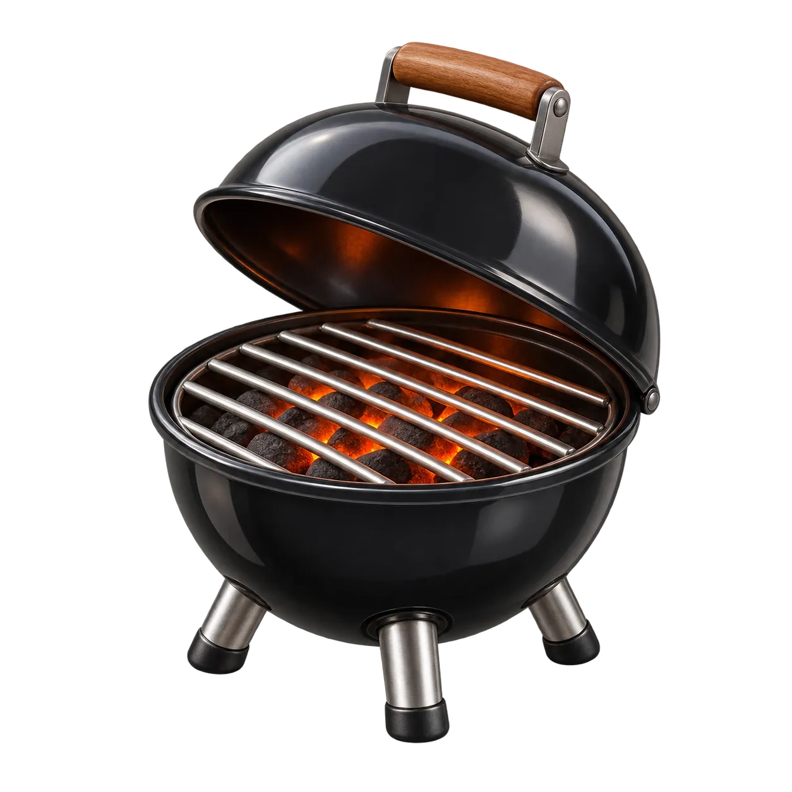

<p align="center">
  
</p>

# The Grill

**Did your change make your LLM server faster? The Grill measures it and tells you.**

Run a short test against the model server you already have. Change something:
the engine, a flag, the model build, the machine. Run it again and get a plain answer:
**measured faster**, **measured slower**, or **inconclusive**.

| I want to... | Use | What you get |
|---|---|---|
| Check whether a serving setup is faster | [Speed benchmarks](#speed-benchmarks)<br>`grill-perf`  | A plain faster / slower / inconclusive answer, the measured change, and the saved evidence |
| Check whether a model answers tasks correctly | [Quality evaluation](#quality-evaluation-wip)<br>`grill`  | Graded answers, with wrong, refused, cut-off, and missing results kept separate |

Both tools run on your machine and connect to a server you already run. No account,
nothing uploaded. Works with any OpenAI-compatible server that reports token usage
while streaming; used so far with vLLM, TensorFold and oMLX on Linux and Apple
Silicon Macs. **This is early, experimental software.**

## Speed benchmarks

### Try it with your coding agent

Paste this into Claude Code, Codex, Cursor or whichever agent you use, on the machine
that runs your model server:

```text
Help me benchmark my LLM server with The Grill: https://github.com/plotarmordev/thegrill
Read its README and docs/performance/INSTALL.md first, and follow them.

1. Download the newest grill-perf release for this machine from
   https://github.com/plotarmordev/thegrill/releases and verify its checksum.
2. Ask me for my server's chat completions URL, the model name, the name of the
   environment variable holding its API key (if it needs one), and my model
   build, engine and version, hardware, and serving settings.
3. Run a baseline with the portable-v1 workload.
4. Stop and wait while I change my server. Ask me what I changed, record it, run
   `check`, and tell me in plain words: measured faster, measured slower or
   inconclusive, the measured change and tokens per second (from report.json),
   and what it does and doesn't prove. (Exit code 2 is a normal answer, not a failure.)

Don't start, stop or reconfigure my server yourself. Don't share or upload the
results folders: they contain my prompts and responses.
```

Each run takes a few minutes at most. The answers mean:

| Answer | Meaning |
|---|---|
| **MEASURED FASTER** / **MEASURED SLOWER** | A clear difference between the two runs |
| **INCONCLUSIVE** | Too close to call, or not enough evidence. Not the same as "equal" |
| **INVALID** | Something in the run or the evidence failed a check; the report says what |

A difference between two runs doesn't prove your change caused it: time, load and
caches can move results too. An unchanged control run shows how much. Prefer doing it
by hand? [Install and first capture](docs/performance/INSTALL.md) has every step.

### Example: the same model on a DGX Spark and a Mac Studio

The same 4-bit Qwen3.8-Flash-Next checkpoint, served by TensorFold 0.6.0 on each machine:

| One request at a time | DGX Spark (GB10) | Mac Studio (M5 Ultra) |
|---|---|---|
| Output speed | 118 tok/s | 246 tok/s |
| Answer | | **MEASURED FASTER**, +108.7% |
| Repeat of the Spark run | -0.2% (stable) | |

This compares two whole setups, not two chips: the Mac build couldn't use two of the
Spark's settings, and the test's counting prompt suits speculative decoding.
[How to compare two machines](docs/performance/INSTALL.md#compare-two-deployments-aba2).

### More tests

Besides the quick test, `grill-perf` includes the
[sparkDash](https://github.com/MiaAI-Lab/sparkDash) decode and prefill tests,
long prompts, coding prompts, multi-request tests and conversation history checks.
See the [list of tests](docs/performance/INSTALL.md#optional-selections-and-failures)
and the [full speed guide](docs/performance/README.md).

Experimental image CLI workload admission is available through
[`grill-perf media preflight`](docs/performance/MEDIA.md); it launches nothing.

## Quality evaluation (WIP)

A second tool, `grill`, checks model answers against task rules. It is not ready
yet: the included questions are synthetic examples, not a validated intelligence test.

<details>
<summary>Try it anyway with your agent (Linux)</summary>

```text
Build the quality tool `grill` from https://github.com/plotarmordev/thegrill from
source, following its README and docs/PROJECT.md (Linux, Rust 1.98, a C/C++
toolchain and CMake). Ask me for my server's chat completions URL and model name,
run examples/synthetic-pack.json against it with streaming and a 4096-token cap,
then inspect the results and explain which answers passed, failed, were refused or
were cut off. Don't touch my server, and don't share the results folder.
```

[How quality evaluation works](docs/PROJECT.md)

</details>

[Contributing](CONTRIBUTING.md) · [Code organization](docs/REPOSITORY.md) · [Security](SECURITY.md) · [Apache 2.0 license](LICENSE) (releases up to v0.5.0 were MIT)
